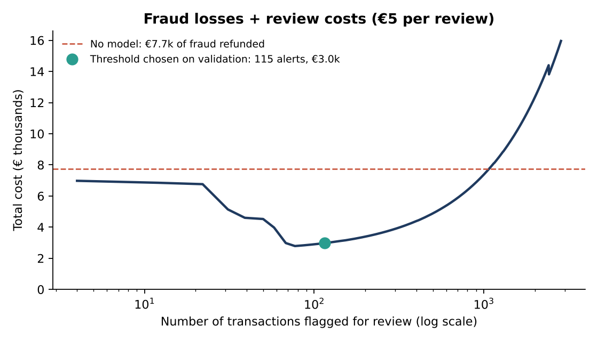
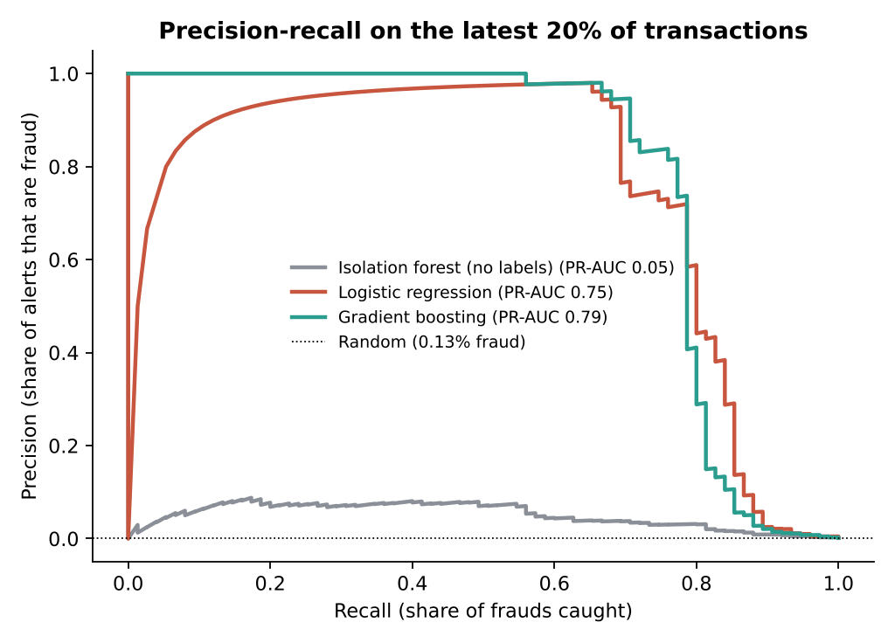
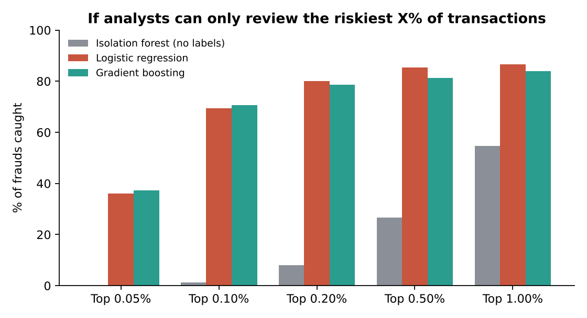

# FraudLens — card-fraud detection judged on money saved

Most fraud projects report 99.9% accuracy. That number is meaningless when only 0.17% of transactions are fraud: a model that never flags anything scores the same. FraudLens asks the question a bank actually asks: **after paying analysts to review alerts, how much fraud loss does a model avoid?**

The data is **284,807 card transactions** from European cardholders over two days in September 2013, of which **492 are fraud**. Models are trained on the earliest 60% of transactions, tuned on the next 20% and tested on the latest 20%, as they would be used in production.



## Results (test period: 56,962 transactions, 75 frauds)

Cost model: a missed fraud costs its full amount, and every alert costs €5 of analyst time. The alert threshold is chosen on the validation period only.

| Model | PR-AUC | Frauds caught | Alerts | Precision | Total cost | Losses avoided |
|---|---|---|---|---|---|---|
| No model (refund every fraud) | – | 0 / 75 | 0 | – | €7,729 | – |
| Isolation forest (no labels) | 0.05 | 44 / 75 | 995 | 4% | €8,393 | **−9%** |
| Logistic regression | 0.75 | 52 / 75 | 56 | 93% | €3,286 | **57%** |
| **Gradient boosting** | **0.79** | **59 / 75** | **115** | **51%** | **€2,974** | **62%** |

1. **A supervised model avoids about 60% of fraud losses** after paying for reviews. The bootstrap 95% interval for gradient boosting's saving is €1,660 to €9,090 over 1.5 days of transactions.
2. **The simple model is almost as good.** Gradient boosting beats logistic regression by about €270 in this period, but the 95% interval for the difference (−€260 to +€1,100) includes zero. Logistic regression raises half as many alerts at 93% precision and is easier to explain to a fraud team, so it is a defensible choice.
3. **Anomaly detection without labels is not enough.** An isolation forest flags unusual transactions, but most unusual transactions are not fraud. At the cost-optimal threshold it costs more than doing nothing.
4. **The conclusions survive the cost assumption.** With review costs from €1 to €20, the best supervised model avoids 50–66% of losses (`reports/review_cost_sensitivity.csv`).




## Why each choice

| Choice | Why |
|---|---|
| **Time-based split** | Fraud patterns change. A random split lets the model learn from the future and overstates performance. |
| **PR-AUC, not accuracy or ROC-AUC** | With 0.17% fraud, accuracy is useless and ROC-AUC looks excellent for almost any model (0.95 even for the isolation forest). Precision-recall shows the trade-off fraud teams actually face. |
| **Cost-based threshold** | The right threshold depends on fraud amounts and review costs, not on 0.5. It is tuned on validation data and judged on test data. |
| **Recall at a review budget** | Fraud teams have fixed capacity. "How many frauds do we catch if we can review the riskiest 0.1%?" is the operational question. |
| **Bootstrap intervals** | 75 test frauds is a small number. The intervals show which differences are real. |
| **scikit-learn** | Logistic regression is the explainable baseline, gradient boosting captures interactions, and isolation forest tests whether labels are needed. |
| **pytest** | 7 tests: cost arithmetic, threshold choice, review-budget recall, a chronological split with no overlap, features and data validation. |

## Run it

```bash
pip install -r requirements.txt
python scripts/run_analysis.py   # downloads and validates the data (~100 MB), trains, writes reports/
pytest -q                        # 7 tests
```

## Limitations

- Features V1–V28 are anonymised principal components, so the model cannot be explained in business terms (`reports/figures/importance.png` shows which components matter, not why).
- The data covers only two days, so seasonal and long-term drift cannot be tested.
- The cost model is simplified: it ignores chargeback fees, customer friction from false alerts and partial recovery of losses.

## Data

Machine Learning Group, Université Libre de Bruxelles, and Worldline: *Credit Card Fraud Detection*, Open Database License (ODbL) v1.0. Dal Pozzolo, A., Caelen, O., Johnson, R. A. and Bontempi, G. (2015). Calibrating probability with undersampling for unbalanced classification. *IEEE Symposium Series on Computational Intelligence*. The download script checks the row count (284,807), the number of frauds (492) and the total amount (€25,162,590.01) against the published file.
